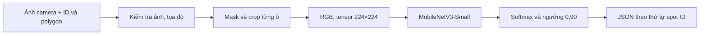

# AI Smart Parking — phần AI

## Bài toán

Camera cố định chụp một bãi xe; mỗi ô đỗ được xác định trước bằng một polygon (vùng đa giác). Module AI nhận ảnh, `camera_id` và danh sách `spot_id` cùng polygon, rồi trả một dự đoán cho từng ô: `empty` (trống), `occupied` (có xe) hoặc `unknown` (chưa đủ tự tin). Người quản trị cấu hình polygon; AI không tự tìm ô đỗ.

AI chỉ phân loại vùng ảnh. Theo thiết kế, backend sẽ quản lý ảnh chụp, lưu kết quả và lịch sử, quyết định FULL/STALE; frontend sẽ hiển thị ô đỗ và cho phép chỉnh polygon. Hai ứng dụng này chưa có mã chạy trong repository. Phần AI không có nhận diện biển số, theo dõi xe hay YOLO.

## Công nghệ và cách hoạt động

Python và FastAPI cung cấp HTTP API; OpenCV cắt vùng ô đỗ; PyTorch/torchvision chạy **MobileNetV3-Small**, một mạng phân loại ảnh gọn cho từng crop. Model học hai lớp `empty=0`, `occupied=1` từ trọng số khởi tạo pretrained. Cách chia việc theo polygon phù hợp với góc camera cố định và vị trí ô đã biết; khi đổi camera hoặc polygon, cần kiểm tra lại.



Crop giữ vùng trong polygon, tô xám phần ngoài và thêm viền để đạt khung 224×224 mà không kéo méo hình. Model cho hai điểm softmax; điểm lớn nhất là `confidence`. Nếu điểm này **nhỏ hơn 0,90**, kết quả cuối là `unknown` nhưng `raw_label` vẫn cho biết lớp model chọn. `unknown` là quy tắc từ chối dự đoán, **không phải lớp thứ ba được huấn luyện**. Điểm softmax chưa được hiệu chuẩn thành xác suất dự đoán đúng.

## Dữ liệu và kết quả

Dữ liệu nghiên cứu là MetaPKLot/PKLot, camera **UFPR04**. Chia theo ngày để ảnh/crop cùng ngày không lọt vào cả tập học và tập kiểm tra: train **2.900 crop / 8 ngày**, validation **720 / 2 ngày**, test độc lập **740 / 2 ngày**. Chỉ dùng validation để chọn checkpoint và khảo sát ngưỡng; checkpoint được chọn ở epoch 2. Bộ test gồm hai ngày nắng, trong đó một ngày chỉ có nhãn `empty`.

| Phép đo W5 trên UFPR04 | Kết quả |
|---|---:|
| Accuracy của bộ phân loại hai lớp | 97,973% (725/740) |
| F1 của lớp occupied | 97,288% |
| UNKNOWN với ngưỡng 0,90 | 28/740 (3,784%) |
| Lỗi false empty vẫn được chấp nhận | 2 |

Các số accuracy/F1 là kết quả **trước** quy tắc UNKNOWN. Benchmark HTTP localhost với **37 polygon khác nhau**: p95 109,0 ms trên GPU và 148,3 ms trên CPU của máy thử nghiệm; không bao gồm backend, mạng xa hay camera. [Báo cáo W5](reports/w5_evaluation_report.md), [benchmark](reports/w5_benchmark_report.md) và [Model Card](docs/MODEL_CARD.md) nêu cách đo, ma trận nhầm lẫn và giới hạn. Chưa đánh giá đủ camera khác, mưa/đêm, 100 polygon thật hoặc tỷ lệ báo FULL sai trên toàn bãi. Release `v0.1.0-rc2` là bản ứng viên, chưa được xác nhận cho production.

## Chạy thử từ repository (Windows, Python 3.11)

Từ **root repository**:

```powershell
py -3.11 -m venv .venv
.\.venv\Scripts\python.exe -m pip install -r ai-service/requirements.txt
$release = (Resolve-Path 'C:\path\to\extracted\v0.1.0-rc2').Path
.\.venv\Scripts\python.exe "$release\verify_release.py"
$env:AI_CHECKPOINT_PATH = Join-Path $release 'model\best.pt'
$env:AI_THRESHOLD_CONFIG = Join-Path $release 'threshold_candidate.json'
.\.venv\Scripts\python.exe -m uvicorn src.service:app --app-dir ai-service --host 127.0.0.1 --port 8001
```

Lấy ZIP `v0.1.0-rc2` qua kênh bàn giao của nhóm, kiểm hash và giải nén trước. Thay đường dẫn ví dụ ở dòng `$release` bằng thư mục thực chứa `model`, `threshold_candidate.json` và `verify_release.py`. Hai biến môi trường cho source repo dùng đúng checkpoint và ngưỡng từ gói; nếu không đặt chúng, [inference.yaml](configs/inference.yaml) mặc định tìm ở `ai-service/runs/mobilenetv3_gpu/`. [Backend handover](docs/BACKEND_HANDOVER.md) ghi SHA-256 ZIP; [Release README](docs/RELEASE_README.md) hướng dẫn cài/verify. ZIP, checkpoint, crop, dữ liệu gốc và các artifact W3/W5 sinh ra đều **không có trong GitHub**. Cài GPU cần cặp `torch`/`torchvision` phù hợp máy; `requirements.txt` không phải lock file.

Ở PowerShell khác, kiểm tra và gọi API (thay đường dẫn bằng ảnh thật và polygon ứng với chính ảnh đó):

```powershell
Invoke-RestMethod http://127.0.0.1:8001/health
Invoke-RestMethod http://127.0.0.1:8001/ready
.\.venv\Scripts\python.exe ai-service/scripts/ai_http_client.py --image C:\path\to\snapshot.jpg --spots C:\path\to\spots.json --camera-id CAM01
```

File `spots.json` chứa mảng JSON như `[{"spot_id":"P01","polygon":[[0.12,0.30],[0.20,0.30],[0.21,0.45]]}]`. Client gửi multipart `image`, `camera_id`, `spots_json` đến `POST /v1/infer`. `/health` chỉ xác nhận tiến trình còn sống; `/ready` phải trả `ready` mới chứng tỏ model đã nạp. Thiếu checkpoint, `/ready` và `/v1/infer` trả 503. Chi tiết: [AI API Contract](docs/AI_API_CONTRACT.md). Có dữ liệu UFPR04 local thì [Demo Runbook](docs/DEMO_RUNBOOK.md) hướng dẫn smoke 37 polygon.

### Kiểm thử trên bản clone sạch

```powershell
.\.venv\Scripts\python.exe -m pytest ai-service/tests -q
```

Các bài `test_baseline_utils.py`, `test_confidence_utils.py`, `test_preprocessing.py`, `test_prepare_dataset.py` chủ yếu kiểm logic bằng input tạo trong test; `test_service.py` và `test_inference.py` dùng mock, nhưng `test_model_loader.py` và `test_w5_evaluation.py` có bài cần checkpoint và kết quả W5 lưu ngoài Git. Bản clone sạch có thể không chạy toàn bộ bộ test. Không coi lỗi thiếu dữ liệu là kết quả kiểm thử model; không chạy lại W5 chỉ để kiểm tài liệu.

## Tìm đúng file

| Việc cần hiểu | File bắt đầu |
|---|---|
| HTTP API và lúc nạp model | [`src/service.py`](src/service.py) |
| Thứ tự các spot và batch inference | [`src/inference.py`](src/inference.py) |
| Polygon, ảnh, tensor và crop W1 | [`src/preprocessing.py`](src/preprocessing.py), [`src/w1_crop.py`](src/w1_crop.py) |
| Trọng số, phiên bản model, UNKNOWN | [`src/model_loader.py`](src/model_loader.py), [`src/confidence_utils.py`](src/confidence_utils.py) |
| Chuẩn bị dữ liệu, huấn luyện | [`scripts/prepare_dataset.py`](scripts/prepare_dataset.py), [`scripts/train_baseline.py`](scripts/train_baseline.py) |
| Kiểm chứng kết quả | [`reports/final_ai_report.md`](reports/final_ai_report.md), [`reports/w5_evaluation_report.md`](reports/w5_evaluation_report.md) |

Đọc thêm: [AI API Contract](docs/AI_API_CONTRACT.md) để biết cách gọi API, [Model Card](docs/MODEL_CARD.md) để xem thông tin mô hình và [Backend ↔ AI plan](docs/BACKEND_AI_INTEGRATION_PLAN.md) khi tích hợp. Công cụ AI có hỗ trợ quá trình phát triển tài liệu và mã; các mô tả ở đây cần được kiểm lại bằng source, test và báo cáo gốc.
