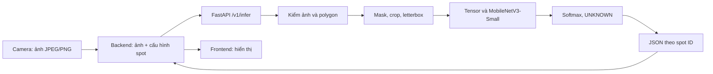

# Tổng quan module AI

## Bài toán và ranh giới

Với camera cố định, vị trí ô đỗ đã biết, câu hỏi của AI là: **trong vùng ảnh của từng ô có xe hay không?** Một ảnh toàn cảnh có thể chứa nhiều ô. Mỗi ô có `spot_id` và polygon do hệ thống quản lý. API trả đúng một dự đoán cho mỗi ID theo thứ tự yêu cầu. Cách này chỉ có nghĩa khi polygon khớp ảnh và góc camera không bị dịch.

Frontend cho quản trị viên chỉnh polygon và hiển thị trạng thái. Backend sở hữu camera/spot ID ổn định, snapshot, lịch sử, kiểm tra phiên bản cấu hình và quyết định FULL/STALE. AI nhận dữ liệu từ backend, không lưu ảnh hay database, không xác định FULL. Tích hợp backend vẫn cần thực hiện theo [kế hoạch W8](BACKEND_AI_INTEGRATION_PLAN.md); bản thiết kế backend và API đang khác nhau ở đường dẫn/schema.

## Đầu vào và đầu ra

`POST /v1/infer` nhận multipart: `image` là JPEG/PNG, `camera_id` là chuỗi, `spots_json` là mảng `{"spot_id":"P01","polygon":[[x,y],...]}`. Mỗi tọa độ được chuẩn hóa vào khoảng `[0,1]` theo chiều rộng/cao ảnh; không dùng tọa độ pixel trực tiếp. Service chấp nhận 1–100 spot, 3–50 đỉnh/polygon và các giới hạn ảnh trong [API contract](AI_API_CONTRACT.md).

JSON thành công có `camera_id`, `model_version`, `threshold`, `predictions` và `processing_time_ms`. Mỗi prediction có `spot_id`, `raw_label`, `label`, `confidence` và hai `scores`. `label` có thể là `unknown`; `raw_label` chỉ là `empty` hoặc `occupied`. Backend phải xác minh ID/số lượng/thứ tự trước khi lưu; lỗi ảnh hoặc polygon là HTTP 4xx, không phải UNKNOWN.

## Một request đi qua những bước nào?

| Bước | Đầu vào → đầu ra | Code |
|---|---|---|
| 1. Nhận snapshot | multipart → bytes ảnh, ID, JSON polygon | [`service.py`](../src/service.py): `infer` trong `create_app` |
| 2. Kiểm request | MIME, kích thước upload, JSON, spot ID → dữ liệu hợp lệ hoặc 4xx | `service.py`, [`preprocessing.py`](../src/preprocessing.py): `validate_spots` |
| 3. Kiểm ảnh/polygon | bytes → ảnh BGR; tọa độ chuẩn hóa → pixel và kiểm diện tích/tự giao | `decode_image`, `polygon_pixels` trong `preprocessing.py` |
| 4. Cắt từng ô | ảnh BGR + polygon pixel → crop có mask xám 114, bounding box và viền 224×224 | [`w1_crop.py`](../src/w1_crop.py): `make_crop`, do `preprocess` gọi |
| 5. Tạo tensor | BGR → RGB → tensor `3×224×224` chuẩn hóa ImageNet; xếp nhiều ô thành batch | `preprocess` và `TRANSFORM` trong `preprocessing.py` |
| 6. Phân loại | batch → hai điểm softmax cho mỗi ô | [`inference.py`](../src/inference.py): `InferenceEngine.infer` gọi [`model_loader.py`](../src/model_loader.py): `ModelLoader.predict` |
| 7. Quyết định UNKNOWN | điểm lớn nhất < 0,90 → final `unknown`; vẫn giữ raw label | [`confidence_utils.py`](../src/confidence_utils.py): `decide` |
| 8. Trả JSON | ghép điểm với `spot_id` theo thứ tự input, thêm version/timing | `InferenceEngine.infer` → `service.py` |

`make_crop` được dùng lại từ bước chuẩn bị dữ liệu W1. Crop W1 được lưu JPEG; API W4 crop trong bộ nhớ nên có sai khác do nén JPEG. Báo cáo W5 đo sai khác này trên validation, không thay đổi tiền xử lý sau test.

## Model và việc nạp trọng số

[`model_runtime.py`](../src/model_runtime.py) dựng MobileNetV3-Small của torchvision và thay lớp cuối thành hai đầu ra. Lúc **huấn luyện**, `train_baseline.py` lấy trọng số pretrained, ban đầu khóa backbone rồi có thể mở ở epoch 3 theo tham số. Lúc **phục vụ**, `ModelLoader` tạo cùng kiến trúc với `pretrained=False` để không tải lại trọng số từ mạng, rồi nạp toàn bộ learned weights từ checkpoint W2. Loader kiểm SHA-256 và metadata với cấu hình W3, chọn CPU/GPU, gọi `eval()`; `predict` dùng `torch.inference_mode()`. Checkpoint chọn ở epoch 2, input 224×224, thứ tự lớp `empty=0`, `occupied=1`.

Model chỉ có hai lớp. Softmax biến hai logits thành hai điểm cộng gần bằng 1. `confidence` là điểm lớn nhất, **chưa phải xác suất dự đoán đúng đã hiệu chuẩn**. Ngưỡng 0,90 là ứng viên từ validation, chưa được xác nhận production. [Model Card](MODEL_CARD.md) ghi số liệu và rủi ro.

## Giới hạn đã biết

Test độc lập 740 crop UFPR04 hai ngày nắng đạt accuracy 97,973% và occupied F1 97,288%; với UNKNOWN 0,90 vẫn có **2 occupied bị chấp nhận là empty**. Chưa kiểm chứng đầy đủ camera khác, mưa, ban đêm, đỗ lệch, vật lạ trong ô hoặc FULL trên snapshot toàn bãi với spot ID ổn định. Benchmark 37 polygon khác nhau chỉ là localhost trên máy thử. Release rc2 chưa production validated. Xem [W5 evaluation](../reports/w5_evaluation_report.md), [benchmark](../reports/w5_benchmark_report.md) và [báo cáo cuối](../reports/final_ai_report.md).
