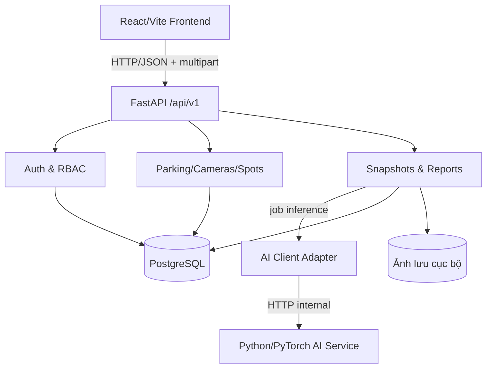
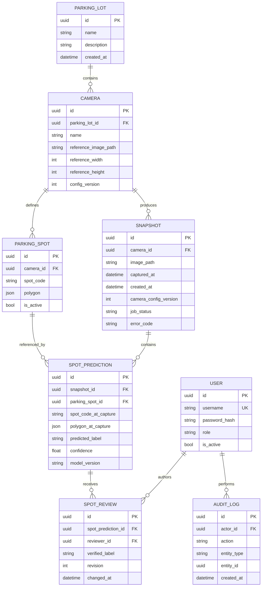
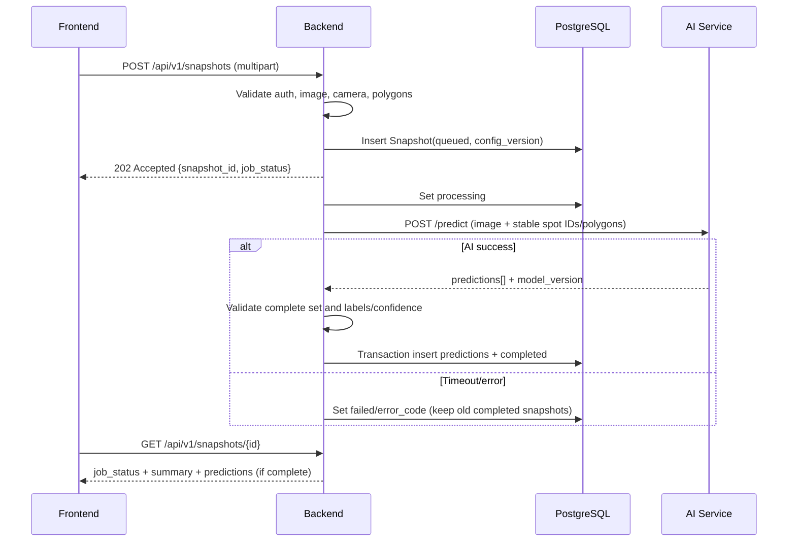

# AI Smart Parking — Backend Architecture & ERD (W1 / 2.2)

**Kiến trúc được chọn:** Modular Monolith FastAPI cho nghiệp vụ + PostgreSQL metadata + thư mục ảnh + AI service độc lập.  
**Đích W2:** Tạo project chạy được, database/migration, auth/RBAC, CRUD; **không** bắt buộc microservices.  
**Nguyên tắc:** Có tài liệu, migration, tests và phân quyền Backend theo hướng Công nghệ phần mềm.

## 1. Thành phần và luồng



Dữ liệu ảnh gốc không nhúng trực tiếp vào PostgreSQL. Database lưu `image_path` tương đối hoặc storage key; API cấp quyền đọc ảnh. AI service không kết nối trực tiếp Database và không tự ghi lịch sử nghiệp vụ.

## 2. Cấu trúc source Backend dự kiến

```text
backend/
  app/
    main.py                    # FastAPI app, routers
    api/v1/                    # Endpoints và dependency auth
    core/config.py             # Pydantic settings, biến môi trường
    core/security.py           # Hash password, JWT
    db/base.py                 # SQLAlchemy base/session
    models/                    # ORM models
    schemas/                   # Pydantic request/response
    services/                  # Business rules
    integrations/ai_client.py  # HTTP client gọi inference
  alembic/                     # Migration, không chỉnh DB bằng tay
  tests/                       # Unit/API/integration tests
  requirements.txt
  README.md
```

## 3. ERD dữ liệu tối thiểu



## 4. Ràng buộc và chính sách

- ID: UUID (do backend sinh), tài liệu API trình bày UUID dạng chuỗi.
- `USER.username` duy nhất; `role` chỉ nhận `admin` hoặc `operator`. Hash mật khẩu, **không** lưu plaintext.
- `PARKING_SPOT`: `UNIQUE(camera_id, spot_code)`. Polygon JSONB là danh sách `{x, y}`, tọa độ đã chuẩn hóa, nằm trong `[0,1]`.
- `SPOT_PREDICTION`: `UNIQUE(snapshot_id, parking_spot_id)`; mỗi snapshot thành công có một prediction cho mỗi ô cấu hình khi chụp.
- `confidence` trong `[0,1]`, nhãn thuộc `empty|occupied|unknown`. Unknown khi kết quả không đủ tin cậy; không được tự biến thành empty.
- `SNAPSHOT.job_status`: `queued|processing|completed|failed`; chỉ `completed` mới đóng góp vào dashboard latest.
- `SNAPSHOT.camera_config_version` và bản copy `polygon_at_capture`, `spot_code_at_capture` giúp xem đúng overlay lịch sử sau khi Admin sửa ô đỗ.
- `SpotReview` append-only; lấy review có `revision` lớn nhất làm `effective_label`. Review phải có `reviewer_id`, thời gian, reason (nếu có). Không chỉnh `predicted_label`.
- `AUDIT_LOG` ghi CRUD cấu hình và review; không chứa credentials, token hoặc nội dung ảnh.
- Tất cả `datetime` dùng UTC timezone-aware (PostgreSQL `TIMESTAMPTZ`).
- Với file upload: kiểm tra nội dung thực tế, giới hạn bytes (`UPLOAD_MAX_MB` từ `.env.example` là 10 MB), tạo filename an toàn; không phục vụ ảnh trực tiếp dưới thư mục public.
- Đối với camera có ảnh khác tỷ lệ/góc nhìn so với tham chiếu: từ chối hoặc đánh dấu cấu hình không tương thích trước inference; không sử dụng polygon của camera khác.

## 5. Trình tự thực thi (job inference)



**Lưu ý vận hành:** Hàng đợi nền đáng tin cậy/chạy lại sau restart là công việc W3/W4. Trong W2 chỉ tạo skeleton và contract; chưa được mô tả là xử lý inference thật. Khi tích hợp, không dùng `BackgroundTasks` in-memory làm giải pháp hàng đợi bền vững nếu bắt buộc chạy lại sau crash; có thể demo local nhưng phải tài liệu hóa giới hạn.

## 6. Định nghĩa hoàn thành W1

- [x] Có ERD tối thiểu với 8 thực thể trong SRS và khóa ngoại/unique quan trọng.
- [x] Chọn kiến trúc API, dữ liệu ảnh, AI adapter, lưu lịch sử không sửa prediction gốc.
- [x] Định nghĩa tương tác và phân quyền cụ thể, các quy tắc FULL/UNKNOWN/STALE.
- [ ] Backend W2 triển khai migration và kiểm chứng qua `alembic upgrade head` + test.
- [ ] AI/Frontend W3/W4 thực hiện tích hợp thực tế theo API Contract.
