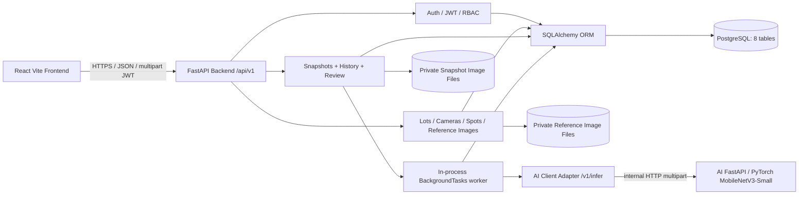
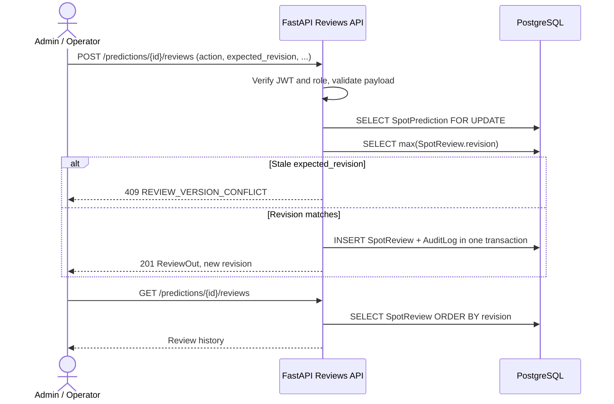

# AI Smart Parking — W6 Backend Architecture as-built

**Task:** 7.4.2 — cập nhật kiến trúc theo các API/worker hiện thực W2–W5, xác minh E2E ở W6.  
**Loại tài liệu:** Bản bổ sung; **không ghi đè** `docs/design/backend-architecture-erd.md` của nhóm.  
**Ghi chú:** Đây là kiến trúc đã kiểm tra trên mã nguồn, không khẳng định độ chính xác thực tế của mô hình AI.

## 1. Component / deployment diagram



- **Frontend** dùng API qua JWT; role phải kiểm tra tại Backend, không dựa trên ẩn/hiện giao diện.
- **Backend** là modular monolith FastAPI; router trong `backend/app/api/`, schema Pydantic trong `backend/app/schemas/`, business logic trong `backend/app/services/`.
- **AI** chạy service độc lập (test W6: localhost `8001`), trả prediction, không ghi PostgreSQL; Backend dùng adapter `backend/app/services/ai_client.py`.
- **PostgreSQL** lưu metadata và lịch sử; file JPEG/PNG lưu trong thư mục riêng, truy xuất qua API có xác thực.
- Cổng `8001`/`8002` là cấu hình demo local, không bắt buộc là deployment production.

## 2. Sequence: snapshot → AI → DB → GET result

```mermaid
sequenceDiagram
  actor Actor as Admin / Operator
  participant API as FastAPI /api/v1
  participant DB as PostgreSQL
  participant Disk as Private Files
  participant Job as BackgroundTasks worker
  participant AI as AI Service /v1/infer
  Actor->>API: POST /snapshots (camera_id, captured_at, image)
  API->>API: JWT, validate camera, reference image, polygons, dimensions
  API->>Disk: Save snapshot JPEG/PNG
  API->>DB: INSERT Snapshot(queued, spots_at_capture, config_version) + Audit
  API-->>Actor: 202 Accepted {id, job_status}
  API->>Job: Schedule run_snapshot_job(snapshot_id)
  Job->>DB: Set job_status=processing
  Job->>Disk: Read stored snapshot
  Job->>AI: POST /v1/infer (image, camera_id, spots_json)
  alt AI 200 + valid response
    AI-->>Job: predictions / confidence / raw_label / scores / model_version
    Job->>Job: Validate count, spot IDs/order, scores and threshold
    Job->>DB: Atomic insert SpotPredictions + Snapshot(completed)
  else AI unavailable / invalid / timeout
    Job->>DB: Snapshot(failed, error_code)
  end
  Actor->>API: GET /snapshots/{snapshot_id}
  API->>DB: Fetch Snapshot, predictions, latest reviews
  API-->>Actor: predicted_label, effective_label, summary, is_stale
```

**Quan trọng:** AI Adapter gọi **`POST /v1/infer`**, không phải `/predict` ở bản sơ đồ thiết kế W1. `unknown` chỉ trả khi AI confidence dưới ngưỡng, không được tự giả `unknown` cho lỗi inference. GET trả `summary` khi job `completed`.

## 3. Sequence: Review / optimistic concurrency



- `action=accept` xác minh AI label gốc. `action=correct` yêu cầu `verified_label` khác label gốc và `reason`.
- GET Snapshot suy ra `effective_label` từ review mới nhất, summary dựa trên nhãn này. Dự đoán AI gốc bất biến.
- Tại W5, GET Review History **suy ra action** từ nhãn; `SpotReview` chưa có cột action. Xem chi tiết ở ERD as-built.

## 4. Entry points và trách nhiệm

| Module | Tệp chính | Vai trò |
|---|---|---|
| App | `backend/app/main.py` | FastAPI, middleware, API routers |
| Auth | `backend/app/api/auth.py`, `deps.py`, `core/security.py` | Login, JWT, RBAC Admin/Operator |
| CRUD | `api/parking_lots.py`, `cameras.py`, `spots.py` | Bãi xe, camera, polygon, config_version |
| Ảnh tham chiếu | `api/reference_images.py`, `services/reference_images.py` | Upload, validate, protected GET |
| Snapshot | `api/snapshots.py`, `services/snapshot_storage.py` | Upload, filtering, detail, private snapshot image |
| Worker | `services/snapshot_jobs.py` | Transition job, AI call, persist predictions |
| AI adapter | `services/ai_client.py` | JSON-to-multipart mapping, strict AI response validation |
| Review | `api/reviews.py`, `schemas/reviews.py` | Accept/Correct, history, version conflict, AuditLog |
| ORM/DB | `models/entities.py`, `db/session.py`, `alembic/` | PostgreSQL metadata, migrations, DB sessions |

## 5. Kết quả E2E đã xác nhận bởi người chạy test W6

- API Backend health, JWT login, camera hợp lệ, AI `/ready` với `mobilenetv3-small-w2-488ed38efe01` trên CPU: PASS.
- POST Snapshot: HTTP 202; ảnh tham chiếu 724x738, 1 polygon; `Snapshot` hoàn tất, 1 prediction được ghi; suy luận AI `44.077 ms`; summary `occupied=1` và `FULL`.
- Ảnh private GET trùng SHA-256 ảnh upload, snapshot xuất hiện trong history, PostgreSQL ghi Snapshot/Prediction/Audit; review history ban đầu rỗng.
- **Giới hạn:** 1 ảnh tham chiếu/1 polygon kiểm tra tích hợp, không đo được accuracy trên dữ liệu camera mới, không chứng minh benchmark của 100 ô.

## 6. Rủi ro và công việc chưa hoàn thiện

- `BackgroundTasks` chạy bên trong web process: restart/crash có thể để lại job `queued/processing`; chưa có durable worker/queue, retry, replay/idempotency.
- Chưa xác nhận API `/reports/snapshots.csv` dù FR-12 yêu cầu xuất CSV. Không mô tả “đã triển khai”.
- `is_stale` ở GET snapshot là độ cũ của **từng snapshot**, chưa phải freshness của latest snapshot cho mỗi camera.
- AI chỉ có internal HTTP, cần mạng private và quản lý quyền truy cập khi triển khai thật.
- Việc dùng checkpoint `v0.1.0-rc2` và một ảnh tham chiếu không chứng minh chất lượng mô hình trên camera mới hoặc giờ đêm/mưa.
- Chưa có Backend CI workflow trên GitHub được xác nhận tại review W5; regression/E2E được chạy tại máy dev và báo PASS.

## 7. Tài liệu và đối chiếu

- `docs/requirements/w6_srs_backend_as_built.md`
- `docs/design/w6_sds_backend_as_built.md`
- `docs/design/w6_erd_backend_as_built.md`
- `backend/reports/w6_7_3_1_api_regression.md`
- `backend/reports/w6_7_3_2_e2e_integration.md`
- Source: `backend/app/models/entities.py`, `backend/app/api/snapshots.py`, `backend/app/api/reviews.py`, `backend/app/services/ai_client.py`, `backend/app/services/snapshot_jobs.py`.
