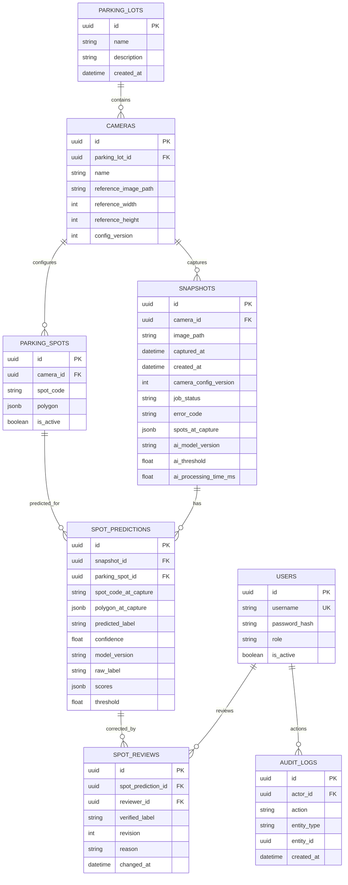

# AI Smart Parking — W6 Backend ERD as-built

**Task:** 7.4.2 — Cập nhật ERD theo các model trong `backend/app/models/entities.py` tại thời điểm hoàn tất W5.  
**Phạm vi:** PostgreSQL/SQLAlchemy của Backend; không thay đổi migration hoặc database.  
**Đối chiếu:** `docs/design/backend-architecture-erd.md` (W1), `docs/design/w6_sds_backend_as_built.md` (W6 7.4.1).

## 1. ERD thực tế — 8 bảng

> Các thuộc tính có thể null theo ORM: `PARKING_LOTS.description`, các trường ảnh tham chiếu của `CAMERAS`, `SNAPSHOTS.error_code`, `SNAPSHOTS.spots_at_capture`, các trường AI metadata, `SPOT_PREDICTIONS.raw_label/scores/threshold`, `SPOT_REVIEWS.reason`. Mermaid liệt kê trường nhưng không biểu diễn đầy đủ quy tắc nullable/constraint.

## 2. Khóa ngoại và quan hệ

| Bảng con | Khóa ngoại | Tham chiếu | Hành vi |
|---|---|---|---|
| `cameras` | `parking_lot_id` | `parking_lots.id` | RESTRICT |
| `parking_spots` | `camera_id` | `cameras.id` | RESTRICT |
| `snapshots` | `camera_id` | `cameras.id` | RESTRICT |
| `spot_predictions` | `snapshot_id` | `snapshots.id` | RESTRICT |
| `spot_predictions` | `parking_spot_id` | `parking_spots.id` | RESTRICT |
| `spot_reviews` | `spot_prediction_id` | `spot_predictions.id` | RESTRICT |
| `spot_reviews` | `reviewer_id` | `users.id` | RESTRICT |
| `audit_logs` | `actor_id` | `users.id` | RESTRICT |

`audit_logs.entity_id` tham chiếu logic đến nhiều loại thực thể và **không có foreign key trực tiếp**. `spot_predictions` gắn với cả snapshot và parking spot; mã ô và polygon được sao chép tại thời điểm chụp để giữ lịch sử không bị sai khi cấu hình camera thay đổi.

## 3. Ràng buộc quan trọng trong ORM

- Unique: `users.username`; `(parking_spots.camera_id, parking_spots.spot_code)`; `(spot_predictions.snapshot_id, spot_predictions.parking_spot_id)`; `(spot_reviews.spot_prediction_id, spot_reviews.revision)`.
- Check: `users.role` thuộc `admin|operator`; `cameras.config_version >= 1`, kích thước tham chiếu dương khi có; `snapshots.job_status` thuộc `queued|processing|completed|failed`; `snapshots.camera_config_version >= 1`.
- Check: `spot_predictions.predicted_label` và `spot_reviews.verified_label` thuộc `empty|occupied|unknown`, `spot_predictions.confidence` trong `[0,1]`, `spot_reviews.revision >= 1`.
- Index: FK ở các bảng liên quan; compound index `(snapshots.camera_id, snapshots.captured_at)` phục vụ tìm lịch sử.
- JSONB trên PostgreSQL (`polygon`, `spots_at_capture`, `polygon_at_capture`, `scores`); ORM dùng JSON chung trong SQLite-based tests.

## 4. Luồng dữ liệu và bất biến

1. `cameras` giữ `config_version`, kích thước ảnh tham chiếu, storage key (không lưu binary trong DB).
2. Khi upload, `snapshots` giữ `spots_at_capture`, `camera_config_version`, `captured_at`, `image_path`; xử lý nền thay đổi `queued → processing → completed/failed`.
3. AI trả kết quả; Backend lưu **mỗi spot một `spot_predictions`** và `completed` trong cùng transaction.
4. Người dùng `admin|operator` tạo `spot_reviews` dạng thêm bản ghi mới; mỗi revision phải là số tăng, không ghi đè `spot_predictions.predicted_label`.
5. `effective_label` **không là cột trong DB**: GET Snapshot suy ra từ nhãn review có revision lớn nhất (hoặc nhãn dự đoán gốc), từ đó tính summary `empty/occupied/unknown` và `FULL`.
6. Mỗi thao tác cấu hình/review thành công tạo `audit_logs`; action review có tên `prediction.review.accept` hoặc `prediction.review.correct`.

## 5. Sai khác với tài liệu W1 và giới hạn cần nêu

- `spot_reviews` hiện **không có cột `action`**; GET Review History suy ra `accept/correct` từ `verified_label` so với nhãn AI gốc. Điều này phù hợp quy tắc hiện tại, nhưng không thể dùng làm log action bất biến cho mọi kịch bản tương lai. AuditLog có action thật cho thao tác thành công.
- `snapshots`/`spot_predictions` đã bổ sung metadata của AI: `raw_label`, `scores`, `threshold`, `ai_model_version`, `ai_threshold`, `ai_processing_time_ms`, và danh sách polygon snapshot hóa.
- Không có bảng queue/retry/idempotency riêng: FastAPI `BackgroundTasks` chỉ đủ demo, không bền qua restart.
- Không có bảng CSV report riêng và chưa xác nhận endpoint xuất CSV; tài liệu không được ghi “đã triển khai” tính năng này.

## 6. Kiểm chứng

Đối chiếu trực tiếp `backend/app/models/entities.py`, các revision Alembic và `backend/tests/`. Các kết quả W6 báo cáo bởi người chạy test trong `backend/reports/w6_7_3_1_api_regression.md` và `backend/reports/w6_7_3_2_e2e_integration.md` (không phải bằng chứng test lại từ tài liệu này).
